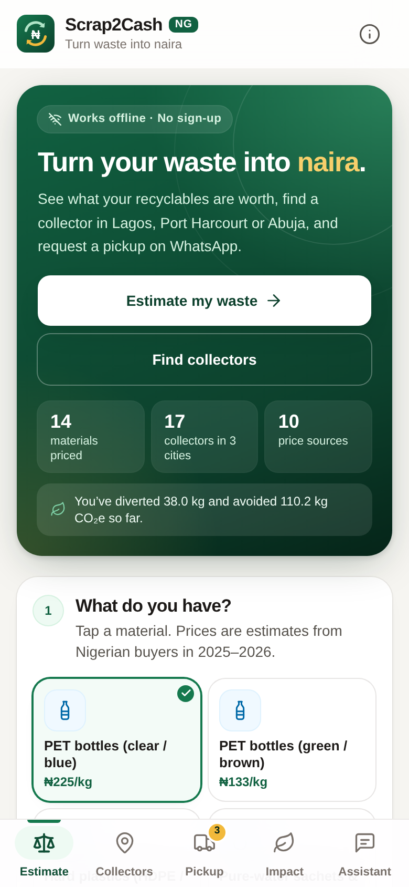
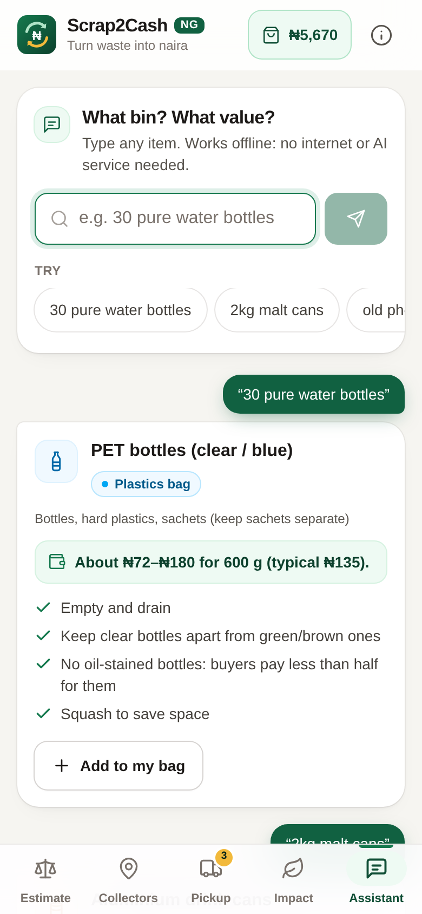
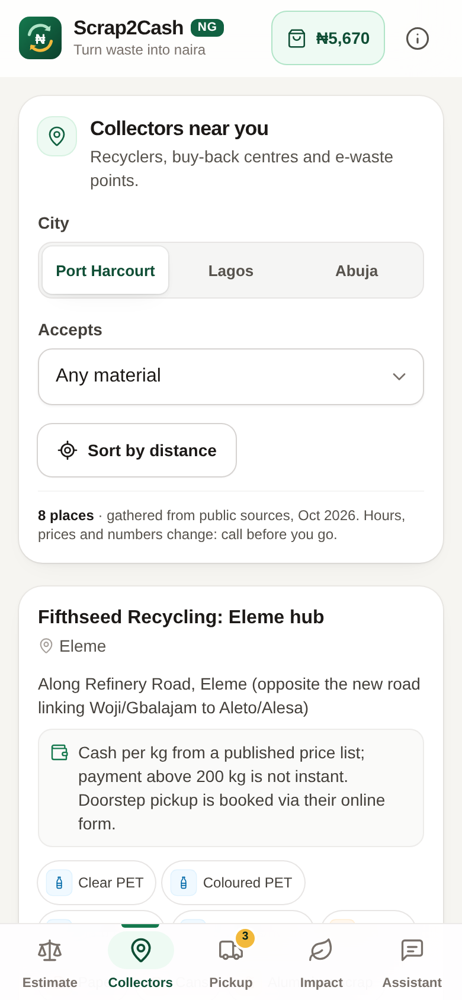
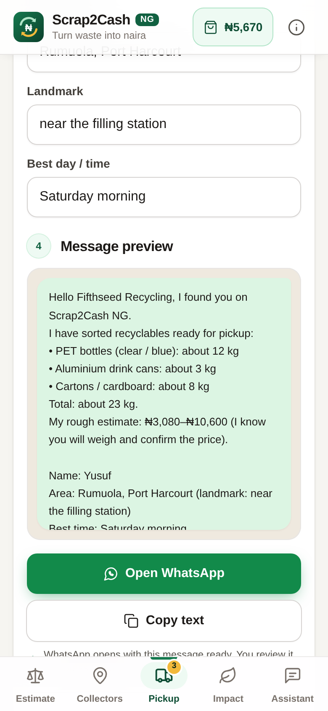
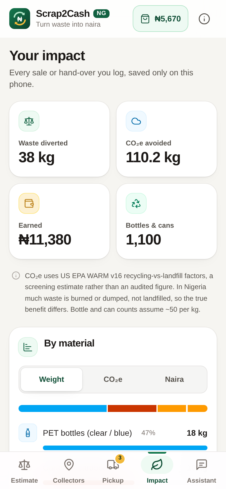

# Scrap2Cash NG ♻️₦

**Turn household recyclables into naira.** Scrap2Cash NG helps Nigerian households and small shops sort their PET bottles, cans, cartons, scrap metal and e-waste, see a transparent naira estimate, find a real collector in **Port Harcourt, Lagos or Abuja**, and send a ready-made pickup request on WhatsApp. An offline impact tracker counts the kilograms kept out of gutters and the CO₂e avoided.

Built for **Arbiter Hacks V1, Theme Track: Rethinking Waste**.

- 📱 Mobile-first, made for low-end Android phones: ~65 kB JS gzipped, system fonts, no images to download, 44 px+ touch targets
- 📴 Works offline after the first visit (service worker); the assistant needs no internet and no API keys
- 🔒 No backend, no account, no tracking. Everything is stored in `localStorage` on the phone
- 🧾 Every price and carbon number is cited (see [Sources](#sources))

| Value | Ask | Collectors | Pickup | Impact |
|---|---|---|---|---|
|  |  |  |  |  |

## The problem

Nigeria has to manage over 2.5 million tonnes of plastic waste a year ([Nairametrics, Apr 2026](https://nairametrics.com/2026/04/07/scavengers-earn-n400000-monthly-as-recycling-business-grows-in-nigeria/)). Yet recyclers *pay* for it: clear PET bottles fetch ₦200–₦300/kg and drink cans up to ₦1,800/kg on published 2026 price lists. The gap is information. Households don't know (1) that their waste has a price, (2) how much, (3) who buys it near them, or (4) how to prepare it so they aren't short-changed. So bottles, cans and cartons end up in drains, dumps and open burning instead of back in a factory.

## Features

1. **Value estimator**: pick a material (14 types), enter kg or simply count bottles/cans (~50 per kg), and get a low–typical–high naira range. Tap “Show how we priced this” to see every quote and its source.
2. **Collectors directory**: 17 real collectors and drop-off points across Port Harcourt, Lagos and Abuja, filterable by material, sortable by distance (location never leaves the phone), with Call / WhatsApp / Directions. Each row says how trustworthy it is: *From their website*, *EPRON official list*, or *Demo data · confirm first*.
3. **WhatsApp pickup request**: choose a collector that accepts your items; Scrap2Cash writes a polite message (items, kg, estimate, area, landmark, best time) and opens `wa.me` with it. Nothing is sent without the user pressing send in WhatsApp.
4. **Impact tracker**: log hand-overs or sales (actual ₦ received or the estimate). Shows kg diverted, kg CO₂e avoided, naira earned, bottles & cans count, a per-material chart and CSV export. Stored in `localStorage`.
5. **Offline “what bin / what value?” assistant**: type “30 pure water bottles”, “2kg malt cans”, “condemn iron” or “used diapers”. A rules engine (English + Nigerian Pidgin/market terms) returns the bin, prep tips, safety advice and a value range. No LLM, no API key, works in airplane mode.

## How the numbers work

**Price band** for each material = lowest quote → highest quote, with **typical = median of the quotes' mid-points**. Quotes are small-quantity (household) buying prices from published buyer price lists and news reports, Oct 2025 – Oct 2026. They are *estimates*: buyers weigh, inspect and deduct for bags, water, sand or oil stains.

**CO₂e saved per kg** = (WARM landfill factor − WARM recycling factor) × 1.102311, using the US EPA Waste Reduction Model v16 (Dec 2023), Exhibit 1-1, in MTCO₂E per short ton. This is a screening estimate: WARM models US systems, and in Nigeria much waste is burned or dumped rather than landfilled, so the real benefit differs.

| Material | ₦/kg low–high | Typical (median) | Quotes | kg CO₂e saved per kg | WARM factor used |
|---|---|---|---|---|---|
| PET bottles (clear / blue) | ₦120–₦300 | ₦225 | westman, nairametrics-2026, ecobarter, fifthseed | 1.17 | PET (recycle -1.04, landfill 0.02) |
| PET bottles (green / brown) | ₦50–₦200 | ₦133 | fifthseed, nairametrics-2026 | 1.17 | PET (recycle -1.04, landfill 0.02) |
| Hard plastics (HDPE / PP) | ₦120–₦280 | ₦200 | westman, fifthseed | 0.86 | HDPE (recycle -0.76, landfill 0.02) |
| Pure-water sachets & nylon | ₦40–₦60 | ₦50 | westman, fifthseed | 1.05 | Mixed Plastics (WARM has no LDPE recycling factor) (recycle -0.93, landfill 0.02) |
| Cartons / cardboard | ₦70–₦200 | ₦90 | westman, fifthseed, jhonks, nairametrics-2026 | 3.66 | Corrugated Containers (recycle -3.14, landfill 0.18) |
| Office / white paper | ₦60–₦60 | ₦60 | westman, fifthseed | 3.99 | Mixed Paper (general) (recycle -3.55, landfill 0.07) |
| Aluminium drink cans | ₦360–₦1,800 | ₦750 | westman, ecobarter, jhonks, fifthseed | 10.09 | Aluminum Cans (recycle -9.13, landfill 0.02) |
| Aluminium scrap | ₦1,000–₦2,500 | ₦1,963 | vmartins, technext, fifthseed, jhonks | 7.96 | Aluminum Ingot (recycle -7.2, landfill 0.02) |
| Iron / steel / tin ("condemn") | ₦200–₦800 | ₦453 | westman, ecobarter, vmartins, technext, fifthseed, jhonks | 2.04 | Steel Cans (recycle -1.83, landfill 0.02) |
| Copper cable (insulated) | ₦2,500–₦3,000 | ₦2,750 | vmartins | 4.97 | Copper Wire (recycle -4.49, landfill 0.02) |
| Copper (bare / stripped) | ₦8,000–₦15,500 | ₦13,000 | vmartins, technext, jhonks | 4.97 | Copper Wire (recycle -4.49, landfill 0.02) |
| Brass | ₦2,000–₦8,000 | ₦7,750 | vmartins, technext, jhonks | 4.86 | Mixed Metals (recycle -4.39, landfill 0.02) |
| E-waste | quote on inspection | – | – | 1.01 | Mixed Electronics (recycle -0.9, landfill 0.02) |
| Glass bottles & jars | quote on inspection | – | – | 0.33 | Glass (recycle -0.28, landfill 0.02) |

Regenerate this table from the data with `npm run table`.

## Collectors (data as of 25 Oct 2026)

| City | Collector | What | Trust level |
|---|---|---|---|
| Port Harcourt | Fifthseed Recycling: Eleme hub & Oyigbo branch | Plastics, sachets, cartons, paper, cans, aluminium, iron; pickup + drop-off; published price list | Website |
| Port Harcourt | MSL Recycling Ltd (Boskel Rd) | PET | Website |
| Port Harcourt | Lustre Plastics (Trans Amadi) | Plastics | Website |
| Port Harcourt | Trashcoin (Eligbolo St) | PET, cartons, cans | Demo data, phone from a map listing |
| Port Harcourt | Kristas Recyclers | PET, cans, cartons, doorstep | Demo data, from a 2025 LinkedIn post |
| Port Harcourt | Soso Care Digital Solutions (Rumuola), Alcimah Solutions (Woji) | E-waste | EPRON list |
| Lagos | Wecyclers (Lagos Island + 7 hubs) | Plastics, cans, glass, paper, cartons; points → cash | Website |
| Lagos | RecyclePoints: Festac & Ebute-Metta hubs | Sachets, PET, cans, glass, paper, cartons; points or cash | Website |
| Lagos | Westman Recycle NG (Lekki, VI, Ikoyi, Ajah…) | PET, cans, cartons, paper, nylon, hard plastics, iron | Website |
| Lagos | V-Martins Metal Recycling (Owode-Onirin) | Iron, aluminium, copper, brass | Website |
| Lagos | Hinckley E-waste Recycling (Ikeja) | E-waste | EPRON list |
| Abuja | Chanja Datti (Durumi) | Plastics, sachets, cans, paper, cartons, glass | Website |
| Abuja | Ecobarter machines (Mabushi, Life Camp, Garki, Kubwa…) | Bottles, cans, paper, sachets, metals | Article (SabiAbuja) |
| Abuja | Energy Return Ltd | E-waste | EPRON list |

Map pins are **approximate neighbourhood coordinates**, used only for distance sorting; “Directions” opens Google Maps with the published address. Phone numbers, hours and prices change, so the app tells users to call first. Edit `src/data/collectors.ts` to add or correct a row.

## Sources

Prices
- Fifthseed Recycling Ltd, Port Harcourt: *Price List 24/10/26* (linked from https://fifthseedrecycling.com/services/): https://docs.google.com/spreadsheets/d/1XYgW8a5D7RBHWZyWwPtipIFo2YH5X-EejqsLbWBkC68/edit?usp=sharing
- Westman Recycle NG, Lagos: “Today's buy rates”: https://westmanrecycle.com/
- Nairametrics (7 Apr 2026): “Scavengers earn N400,000 monthly as recycling business grows in Nigeria”: https://nairametrics.com/2026/04/07/scavengers-earn-n400000-monthly-as-recycling-business-grows-in-nigeria/
- Nairametrics (11 Jul 2025): “From trash to millions…”: https://nairametrics.com/2025/07/11/from-trash-to-millions-how-plastic-waste-collectors-in-nigeria-are-cashing-in/
- SabiAbuja (13 Oct 2025): “Explore Ecobarter: ATM for Plastics in Abuja” (prices, ~50 items/kg, machine locations): https://sabiabuja.com/atm-for-plastics-in-abuja/
- V-Martins Metal Recycling: “Scrap Metal Prices in Nigeria, 2026”: https://www.vmartinsrecyclingcompany.com/scrap-metal-prices
- Technext (30 Jul 2026): “Iron Condemn: Nigeria's ₦200 billion scrap metal industry explained”: https://technext24.com/reviews/how-nigerias-scrap-metal-industry-works/
- Jhonks recycling app, “Available Materials”: https://jhonks.com/

Carbon
- US EPA, *Documentation for GHG Emission and Energy Factors Used in WARM v16: Management Practices Chapters*, Exhibit 1-1: https://www.epa.gov/system/files/documents/2024-01/warm_management_practices_v16_dec.pdf

Collectors
- Wecyclers: https://wecyclers.com/services · RecyclePoints: https://recyclepoints.com/how-it-works-2/ · Chanja Datti: https://www.chanjadatti.com/about · MSL Recycling: https://www.mslrecyclingltd.com/contact · Lustre Plastics: https://lustreplastics.com/ · Trashcoin: https://www.instagram.com/trashcoin.hq · Kristas Recyclers: LinkedIn post (June 2025) · EPRON collection centres: https://epron.org.ng/collection-centres/

## Run it

```bash
npm install
npm run dev        # http://localhost:5173
npm test           # 18 unit tests: pricing, CO2 factors, assistant rules, WhatsApp links, data integrity
npm run build      # type-check + static build in dist/
npm run preview    # serve dist/
npm run screenshots  # rebuild + capture mobile screenshots (needs Python Playwright + Chromium)
```

`dist/` is fully static (relative `base: './'`), so it deploys as-is to Vercel, Netlify, Cloudflare Pages or GitHub Pages. No environment variables, no secrets.

## Tech

Vite 6 · React 18 · TypeScript (strict) · Tailwind CSS v4 · Vitest · a hand-written service worker · `wa.me` deep links · `navigator.geolocation` (optional) · `localStorage`.

```
src/
  data/       materials.ts (price quotes + WARM factors), collectors.ts, sources.ts
  lib/        estimate.ts, assistant.ts (offline rules engine), whatsapp.ts, geo.ts, storage.ts
  components/ EstimateView, AskView, CollectorsView, PickupView, ImpactView, AboutView
public/       sw.js (offline cache), manifest.webmanifest, icon.svg
tests/        core.test.ts
```

## Accessibility

Semantic landmarks and a skip link, visible focus rings, labelled inputs, `aria-live` updates for estimates and assistant answers, radio-group semantics for material choice, no colour-only meaning (every bin colour also has a text label), `prefers-reduced-motion` respected, large tap targets, works at 200% zoom.

## Limitations (honest list)

- Prices are a snapshot from public quotes, not live. A collector's real offer can be well above or below the band.
- Some collector rows are demo-grade (marked in the app). Nobody has phoned every number yet.
- CO₂e factors are US EPA WARM values used as a proxy for Nigeria.
- The assistant is keyword rules, not computer vision: it can miss unusual phrasing.

## Credits & AI disclosure

Built by **Balogun Yusuf Olatunji** (Port Harcourt). Code, data research and documentation were produced with substantial help from an AI assistant (Hark), directed and reviewed by the author. All price, collector and carbon data comes from the public sources cited above. The app itself uses no AI model at runtime.

License: MIT.
